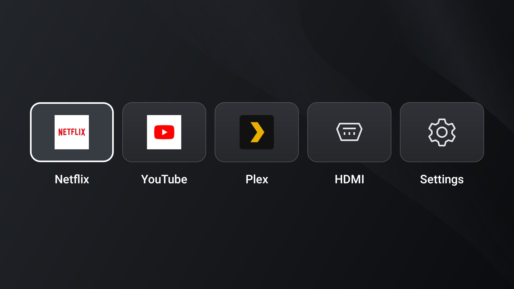

<div align="center">

# 📺 Lightweight TV

### Your apps. One row. Straight to watching.

*A small Android TV launcher with five clear destinations, a graphite backdrop, and remote controls that stay simple.*

[](#-getting-started)
[](app/src/main/java/nz/tony/tvlauncher/MainActivity.java)
[](app/build.gradle)
[](#-tech-stack)
[](app/src/main/AndroidManifest.xml)

</div>

---

<p align="center">
  
  <br><sub>Version 0.2.0 running on a Philips TV. Streaming app icons come from the installed apps.</sub>
</p>

## ✨ Features

- 📺 **Five destinations.** Netflix, YouTube, Plex, HDMI and Settings in one centered row.
- 🎮 **Made for the remote.** Explicit D-pad navigation, a clear white focus outline and OK to open.
- 🌑 **Quiet design.** Rounded cards, a static graphite background and large, always-visible labels.
- ↩️ **Focus stays with you.** Return to the selected tile after leaving the launcher.
- 🔌 **HDMI selection.** Opens a single available input or shows a native picker for multiple inputs. Uses the TV's standard input APIs.
- 🪶 **Small by design.** One Java Activity and Android platform Views. The evaluated debug APK is about 51 KiB.
- 🔒 **No permissions or background work.** No network requests, accounts, feeds, services or animation loop in the launcher.

The streaming apps handle their own accounts, playback and network access. Installing this launcher does not replace YouTube, Netflix or Plex.

## 🎮 How to use

Use **Left / Right** to choose a tile and **OK** to open it. The white border shows the current selection. Once configured as the default launcher, **Home** brings you back here.

| Tile | Opens |
| --- | --- |
| Netflix | Installed Android TV app: `com.netflix.ninja` |
| YouTube | Installed Android TV app: `com.google.android.youtube.tv` |
| Plex | Installed Android TV app: `com.plexapp.android` |
| HDMI | Standard TV passthrough input or input picker |
| Settings | Android system settings |

Unavailable apps and inputs show a message. If the TV does not expose HDMI switching to ordinary apps, use the remote's **Source** button. The five destinations are fixed in this version.

## 🛠️ Tech stack

| Part | Version / detail |
| --- | --- |
| UI | Native Android Views, XML layouts and vector artwork |
| Language | Java, Java 8 source compatibility |
| Minimum / target SDK | 30 — Android 11 |
| Compile SDK | 34 |
| Build tools | 35.0.0 |
| Gradle / Android Gradle Plugin | 8.9 / 8.7.2 |
| Build JDK | 17 |
| Package | `nz.tony.tvlauncher` |
| Runtime libraries | Android platform only |

This is a personal evaluation build. Its target SDK and debug signing are not suitable for a Play Store release.

## 📁 Project structure

```text
lightweight-tv-launcher/
├── app/
│   ├── build.gradle
│   └── src/main/
│       ├── AndroidManifest.xml
│       ├── java/nz/tony/tvlauncher/MainActivity.java
│       └── res/                 # Layout, labels, colors and vector artwork
├── docs/media/                  # Screenshot from the TV
├── scripts/verify_artifact.py    # Static manifest, navigation and contrast checks
├── gradle/wrapper/              # Pinned Gradle wrapper
├── build.gradle
└── settings.gradle
```

## 🚀 Getting started

Install **JDK 17** and the Android SDK with **platform 34** and **build-tools 35.0.0**. Set `JAVA_HOME` and `ANDROID_HOME` for your machine. The first build needs internet access to fetch the pinned build tools and dependencies.

```sh
git clone https://github.com/k0nkupa/lightweight-tv-launcher.git
cd lightweight-tv-launcher

./gradlew --no-daemon :app:assembleDebug :app:lintDebug \
  -x :app:lintAnalyzeDebugUnitTest -x :app:lintAnalyzeDebugAndroidTest

python3 scripts/verify_artifact.py
python3 scripts/verify_artifact.py \
  app/build/intermediates/merged_manifests/debug/processDebugManifest/AndroidManifest.xml
```

APK output: `app/build/outputs/apk/debug/app-debug.apk`.

These commands assemble, lint and run static artifact checks. They do not execute unit or instrumentation tests. Test-source lint analysis is excluded. Do not substitute the broader `build`, `check` or `test` tasks.

### Install on your TV

Enable debugging on the TV, connect it with ADB and accept its authorization prompt. Replace `TV_SERIAL` with the device shown by `adb devices`.

```sh
adb devices
adb -s TV_SERIAL install -r app/build/outputs/apk/debug/app-debug.apk
adb -s TV_SERIAL shell am start -n nz.tony.tvlauncher/.MainActivity
```

Open it as an ordinary app first and check the remote, streaming apps and HDMI. Installation alone does not change the default Home screen.

The APK is debug signed. Gradle creates a local debug key if needed. A build signed with a different key cannot update an existing installation. Keep your signing key private and reuse it for updates.

### Make Home open Lightweight TV

Use your TV's launcher/default-home selection if it offers one. With an authorized ADB connection, Android also provides:

```sh
adb -s TV_SERIAL shell cmd package set-home-activity --user 0 nz.tony.tvlauncher/.MainActivity
adb -s TV_SERIAL shell cmd package resolve-activity --brief \
  -a android.intent.action.MAIN -c android.intent.category.HOME
```

Press **Home** and confirm the result on the TV. Firmware can override this preference: the Philips evaluation unit required a separate, reversible stock-launcher setting change. That workaround is device specific and is not performed by this app.

Before changing launcher packages, record the existing Home component and keep an ADB recovery path. To remove Lightweight TV later, restore and verify another Home app first. Do not uninstall the active launcher before a replacement works.

## ✅ Verification

Version 0.2.0 was assembled and linted, checked against the merged manifest, and exercised in a disposable 1920×1080 emulator. Static checks cover the manifest, five labelled destinations, D-pad reachability and text contrast.

On the Philips TPM191E evaluation TV running Android 11:

- Installation, the five-tile display and injected D-pad navigation were checked.
- Home resolution was verified after configuration.
- The user confirmed the tiles worked, YouTube picture and sound were normal, and the physical Home button returned to the launcher.
- The user reported standby/wake in about two seconds, returning to the launcher. This is a reported observation, not a controlled benchmark.

**Still unverified:** full reboot behavior and broader device compatibility. Real HDMI switching was not separately recorded as a passed check. No unit tests or Jest were run.

## 🙏 Credits

The rounded cards and graphite look were inspired by **[Luma TV](https://github.com/0xProbabillity/luma-tv)**. No Luma source code or assets were copied. This launcher has no smart-home integration.

Bundled vector artwork was drawn for this project. Netflix, YouTube and Plex names and logos belong to their respective owners; installed app icons are loaded from those apps at runtime.

## 📜 License

No open-source license has been granted for this repository. All rights reserved for original project code and artwork; third-party names and marks remain with their owners. The Gradle wrapper retains its included Apache 2.0 notices.
